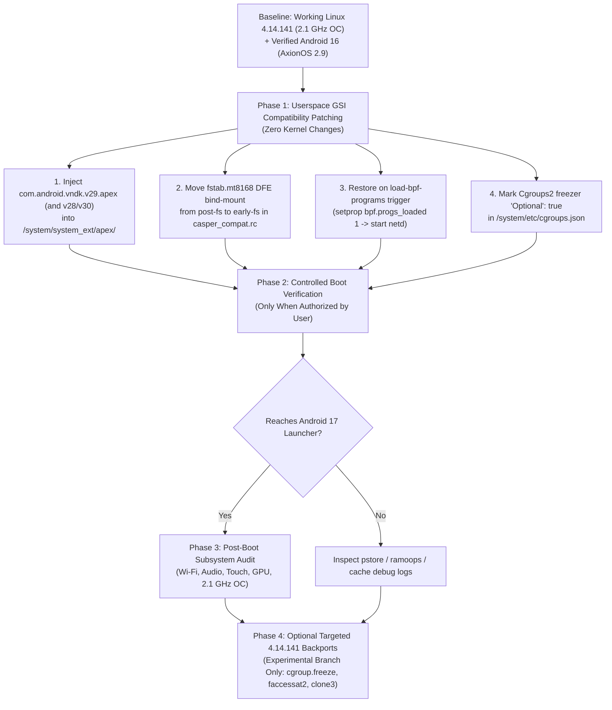

# MT8168 Kernel Upgrade Feasibility & Strategic Recommendation

- **Device:** Casper VIA S48 (`MT8168` / `F716`)
- **Current Working Kernel:** `Linux 4.14.141` (`SMP PREEMPT #10`, 2.1 GHz Overclocked, branch `android-16` / `oc-2.1ghz-experimental`)
- **Current Verified OS:** AxionOS 2.9 (Android 16 QPR2 / API 36)
- **Target OS:** Android 17 (Baklava / API 37)
- **Status:** **FEASIBILITY AUDIT COMPLETE**

---

## 1. Mission Overview

This document synthesizes the results of our comprehensive engineering audit across:
1. [Android 17 Minimum Kernel Requirements](android17-minimum-kernel-requirements.md)
2. [MT8168 / F716 Hardware Driver Migration Audit](mt8168-driver-migration.md)
3. [Kernel Version Technical Comparison Matrix (`4.14` – `5.15`)](kernel-version-comparison.md)

Our objective is to determine whether booting and running Android 17 on the Casper VIA S48 is best achieved via:
- **Path A (Minimum-Change Path):** Keep `Linux 4.14.141`, fix the confirmed userspace Treble/init blockers, and backport only verified missing kernel features.
- **Path B (Conservative Kernel Upgrade):** Migrate to `Linux 4.19.x`.
- **Path C (Long-Term Modernization):** Migrate to `Linux 5.4.x`, `5.10.x`, or `5.15.x`.

---

## 2. Strategic Evaluation of the Three Paths

### Path A: Minimum-Change Path — Keep `Linux 4.14.141` + Userspace Compatibility + Targeted Backports (**RECOMMENDED PRIMARY PATH**)

#### Technical Justification
1. **Android 17's Boot Failure Was Caused by Userspace GSI Packaging & Init Ordering, Not Linux 4.14.141:**
   - Binary and filesystem forensics comparing working **AxionOS 2.9 (Android 16)** against **BlazeAOSP (Android 17)** proved that our `Linux 4.14.141` kernel already satisfies all mandatory early-boot primitives: `0x4000` ELF alignment, ARMv8.0 outline-atomics, `CLONE_NEWNS` mount namespaces, `dm-verity` (`sha256-ce`), loop device allocation (`loop0..loop46`), `PSI` (`CONFIG_PSI=y`), `uclamp` (`CONFIG_UCLAMP_TASK=y`), static Binder (`binder`, `hwbinder`, `vndbinder`), and hybrid `cgroup v1/v2`.
   - The actual causes of the BlazeAOSP fastboot fallback were:
     1. **Missing `com.android.vndk.v29.apex`** in BlazeAOSP's `/system/system_ext/apex/` (whereas AxionOS includes `v28`, `v29`, `v30`, `v31`, `v32`, `v33`, `v34`), preventing `linkerconfig` and all Android 10 vendor HALs (`boot@1.0`, `health@2.0`, `keymaster@4.0`, `allocator@2.0`) from linking.
     2. **Late bind-mount of `/vendor/etc/fstab.mt8168`** at `on post-fs` instead of `on early-fs` (after `init.mt8168.rc` had already run `mount_all` at `on fs` using the stock encrypted fstab, triggering `reboot,vold-failed`).
     3. **Lost `on load-bpf-programs` trigger** when replacing `netbpfload.rc`, preventing `bpf.progs_loaded=1` and `netd` startup.
2. **100% Hardware & Overclock Preservation:**
   - Retains our verified 2.1 GHz overclock (`d6ce48d16`, `84ff56e2a`), repaired `EK79029`/`JD9365DA` display panel initialization (`d60cc9645`), 5,247-record `GSL1680` touchscreen firmware (`20189f473`), `mali-r20p0` GPU driver, and in-kernel `via_s48_connsys_preload` (`f4abafafd`) for Wi-Fi/BT/GPS.

#### Safe Targeted Backports Available for `Linux 4.14.141` (If Required Post-Boot)
If specific Android 17 services benefit from newer kernel primitives after reaching the launcher, the following self-contained features can be safely backported from `android-4.19-stable` / `android-5.4` into a dedicated experimental branch of `kernel_casper_mt8168` without breaking `.ko` module vermagic/CRCs:
- **Cgroup v2 Freezer (`kernel/cgroup/freezer.c`):** ~350 LOC backport from Linux 5.2 / `android-4.19-stable` adding `cgroup.freeze` and `cgroup.events` to unified `cgroup2` for Android's Cached App Freezer.
- **Process Descriptor Syscalls (`pidfd_open`, `pidfd_send_signal`, `pidfd_getfd`):** Self-contained syscalls in `kernel/pid.c` and `kernel/signal.c`.
- **`faccessat2` (`__NR_faccessat2 = 439`) & `openat2` (`__NR_openat2 = 437`):** Small VFS syscall wrappers in `fs/open.c` (< 200 LOC).
- **`BPF_MAP_TYPE_RINGBUF` (`kernel/bpf/ringbuf.c`):** Self-contained ~700 LOC BPF map implementation from Linux 5.8 (if native BPF ringbuf map allocation is desired).

---

### Path B: Conservative Kernel Upgrade — Migrate to `Linux 4.19.x` (**NOT RECOMMENDED AS FULL PORT; USE AS BACKPORT DONOR ONLY**)

#### Advantages
- MediaTek released ALPS `kernel-4.19` BSPs for `MT8168` / `MT6765` that share the same legacy `mtkfb`/`lcm`, `mtk_tpd`, and staging `mtk_ion` architecture as `4.14`.
- Includes Google's `android-4.19-q` / `android-4.19-r` common kernel updates.

#### Disadvantages & Fatal Blockers
1. **Breaks Prebuilt Connectivity Modules (`wmt_drv.ko`, `bt_drv.ko`, `wmt_chrdev_wifi.ko`, `wlan_drv_gen4m.ko`):**
   - Our Wi-Fi, Bluetooth, GPS, and FM Radio rely on prebuilt `4.14.141` `.ko` binaries whose out-of-tree source (`vendor/mediatek/kernel_modules/connectivity/`) is not publicly available for F716. A `4.19` kernel cannot load `4.14.141` kernel modules.
2. **Does Not Solve Android 17's GKI/eBPF Requirements Anyway:**
   - Linux 4.19 still lacks Linux 5.8+ `BPF_MAP_TYPE_RINGBUF` / CO-RE BTF and `FUSE-BPF`, meaning `4.19` requires the **exact same userspace shims** as `4.14.141`!
3. **Verdict:** Migrating the entire kernel base to `4.19` incurs massive hardware regression (loss of Wi-Fi/BT) for zero gain in Android 17 compatibility compared to cherry-picking isolated `4.19` commits into `4.14.141`.

---

### Path C: Long-Term Modernization — Migrate to `Linux 5.4`, `5.10`, or `5.15` (**INFEASIBLE WITH STOCK ANDROID 10 VENDOR BLOBS**)

#### Advantages
- Native GKI 2.0 eBPF (`5.10` / `5.15`), native cgroup v2 freezer, and modern memory management.
- Mainline and MediaTek IoT Yocto support exists for the sibling `MT8365` (Genio 350) SoC.

#### Disadvantages & Fatal Blockers
1. **Bootloader (`LK`) DTBO Overlay Incompatibility:**
   - Casper VIA S48's Little Kernel (`LK`) dynamically applies `tb8168p1_64_bsp_f716` DTBO overlays onto `mt8168_dtbo` using ALPS-specific node names and phandle fixups. Mainline/IoT `mt8365.dtsi` lacks these nodes, causing `LK` to abort boot and drop directly into fastboot.
2. **Total Incompatibility with Stock Android 10 Vendor HALs (`VNDK 29`):**
   - **Display:** `5.4+` uses `CONFIG_DRM_MEDIATEK` (`/dev/dri/card0`), whereas stock `hwcomposer.mt8168.so` requires `/dev/mtkfb` and `/dev/mtk_cmdq`.
   - **Memory & GPU:** `5.10+` removed staging `ION` (`/dev/ion`), whereas stock `gralloc.mt8168.so` and `libGLES_mali.so` (`mali bifrost r20p0`) require `/dev/ion` (`MTK_ION`) and `/dev/mali0` (`r20p0` + `ged`).
   - **Connectivity:** No `MT6631` `CONSYS_8168` `wmt_drv` / `wlan_drv_gen4m` driver in mainline `5.15`.
3. **Verdict:** A `5.x` kernel is only viable for a non-Android mainline Linux/Yocto distribution (using Panfrost + DRM + open-source userspace) and cannot run Android 16/17 on top of Casper VIA S48's Android 10 vendor partition.

---

## 3. Realistic Step-by-Step Implementation Strategy for Android 17

The following is an archived, unverified Android 17 BlazeAOSP bring-up proposal. It is not an active development roadmap or an installation guide:

### Phase 1: Userspace GSI Compatibility Patching (No Kernel Risk)
1. **VNDK 29 APEX Injection:** Copy `com.android.vndk.v29.apex` (from `Axion-2.9-patched.img`) into the target Android 17 GSI at `/system/system_ext/apex/com.android.vndk.v29.apex` with `0644` permissions and `u:object_r:system_file:s0` SELinux label.
2. **Early-FS Fstab Override:** Update `/system/etc/init/casper_compat.rc` so that `mount none /system/etc/fstab.mt8168 /vendor/etc/fstab.mt8168 bind` executes on `early-fs` **before** `/vendor/etc/init/hw/init.mt8168.rc` runs `mount_all` on `fs`.
3. **BPF Trigger & Netd Startup:** Ensure `on load-bpf-programs` in `/system/etc/init/casper_compat.rc` (or `netbpfload.rc`) sets `setprop bpf.progs_loaded 1` so `netd` starts without triggering `reboot,bpfloader-failed`.
4. **Cgroups Fallback:** Add `"Optional": true` to the `Cgroups2` `freezer` controller in `/system/etc/cgroups.json` so `libprocessgroup_setup` does not abort if unified `cgroup.freeze` is absent.
5. **Retain Proven Treble Shims:** Keep `compatibility_matrix.4.xml`, `persist.sys.fuse.bpf.override=false`, `hwservicemanager.always_sets_disabled=false`, sanitized `media_codecs_mediatek_audio.xml`, and `sys.usb.controller=11201000.usb`.

### Phase 2: Optional Targeted Kernel Backports (Isolated Experimental Branch)
- Only if post-boot testing reveals a service requiring unified cgroup v2 freezer or a specific modern syscall, create an isolated git branch (`android17-backports-experimental`) from `android-16` without modifying `oc-2.1ghz-experimental` or changing `MODVERSIONS` symbol CRCs used by `via_s48_connsys_preload`.
