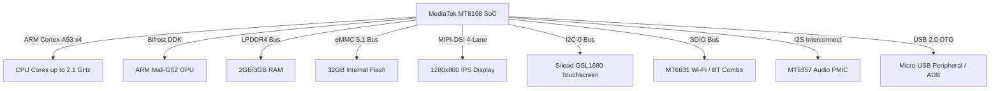

# Casper VIA S48 Hardware Overview

The **Casper VIA S48** (internal board codename: `F716` / `tb8168p1_64_bsp`) is a MediaTek-powered Android tablet released with Android 10.

---

## 1. Technical Specifications

| Component | Specification |
| :--- | :--- |
| **System-on-Chip (SoC)** | MediaTek MT8168 (12nm FinFET Process) |
| **CPU Architecture** | Quad-core ARM Cortex-A53 (64-bit ARMv8-A) |
| **CPU Frequency** | Stock: 2.0 GHz (2,000,000 kHz) \| Overclocked: 2.1 GHz (2,100,000 kHz) |
| **Graphics Processing Unit** | ARM Mali-G52 MP1 (Bifrost Architecture) |
| **RAM** | 2 GB / 3 GB LPDDR4 @ 1600 MHz |
| **Internal Flash Storage** | 32 GB eMMC 5.1 (Micron / Samsung / Kingston) |
| **Display Panel** | 8.0" / 10.1" IPS LCD (1280x800 WXGA), 60 Hz Refresh Rate |
| **Touch Controller** | Silead GSL1680 (I2C interface, 10-point capacitive multitouch) |
| **Wireless Connectivity** | MediaTek MT6631 (Dual-band 802.11a/b/g/n/ac Wi-Fi, Bluetooth 5.0, GPS) |
| **Power Management (PMIC)** | MediaTek MT6357 PMIC + Fuel Gauge |
| **Battery Capacity** | 4,000 mAh Li-Polymer (3.8V nominal, 4.35V charge termination) |
| **Audio Hardware** | Mono/Stereo internal loudspeaker, 3.5mm TRRS analog audio jack, MEMS mic |
| **USB Interface** | USB 2.0 High-Speed OTG (Micro-USB or USB Type-C dependent on sub-rev) |
| **Camera Sensors** | Front: 2.0 MP (GalaxyCore GC2385) \| Rear: 5.0 MP (OmniVision OV5670) |

---

## 2. Block Diagram

